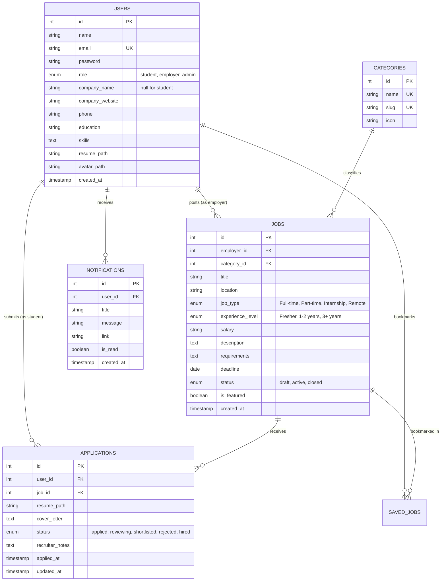
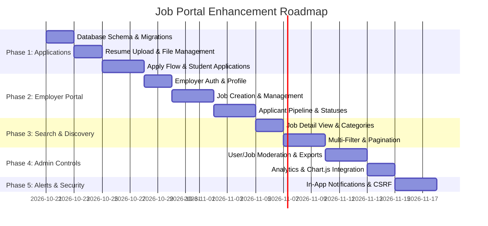

# Job Portal - Feature Enhancement & Architecture Roadmap

This document outlines a phased development plan to transform the existing lightweight prototype into a robust, full-featured Job & Internship Portal.

---

## 1. Current State vs. Target State Analysis

| Domain | Current Implementation | Planned Target Capability |
| :--- | :--- | :--- |
| **User Roles** | `student`, `admin` | `student`, `employer` / `recruiter`, `admin` |
| **Job Applications** | None (only "Save job" bookmarking) | Full application workflow: resume upload, cover letter, application status tracking |
| **Employer Experience** | Non-existent (admin posts directly) | Dedicated Employer Dashboard: post jobs, manage listings, review applicants, update statuses |
| **Resume Handling** | Plain text skills field in database | PDF/DOCX resume file upload, storage, preview, and download |
| **Job Search & Filters** | Simple client-side text filtering | Multi-faceted search: category, job type, location, experience level, salary range, pagination |
| **Admin Controls** | View stats, feedback, basic report list | Full CRUD for jobs & users, company verification, job approvals, CSV export, analytics charts |
| **Notifications** | None | In-app notification bell + email alerts on status changes |
| **Security & Forms** | Basic PDO prepared statements | CSRF token protection, strict file upload MIME validation, input sanitization |

---

## 2. Target Database Schema Enhancements

---

## 3. Phased Implementation Roadmap

### Phase 1: Core Job Application System (Priority: Critical)
> **Goal**: Turn the portal from a read-only job catalog into an active hiring platform where students can actually apply.

- [ ] **Database Migration**:
  - Create `applications` table with foreign keys to `users(id)` and `jobs(id)`.
  - Add `resume_path` and `avatar_path` columns to `users`.
- [ ] **Resume Upload & Storage**:
  - Secure upload handler in `student/profile.php` supporting `.pdf` and `.docx` (max 5MB).
  - Save files to `uploads/resumes/` with uniquely generated filenames.
- [ ] **Job Application Modal / Page**:
  - Add "Apply Now" button to job cards and detail view.
  - Option to apply with profile resume or upload a custom tailored resume.
  - Optional cover letter input field.
  - Prevent duplicate applications to the same job.
- [ ] **Student "My Applications" Dashboard**:
  - New page `student/applications.php` displaying applied jobs, date applied, and current status badges (`Pending`, `Reviewing`, `Shortlisted`, `Rejected`, `Hired`).

---

### Phase 2: Employer & Recruiter Portal (Priority: High)
> **Goal**: Allow companies to sign up, manage job openings, and review applicants.

- [ ] **Employer Authentication & Profile**:
  - Add `role = 'employer'` support during registration.
  - Employer profile setup: company name, company description, website URL, company logo.
- [ ] **Employer Dashboard (`employer/dashboard.php`)**:
  - Metrics: active jobs, total applications received, shortlisted candidates.
- [ ] **Job Posting & Management (`employer/manage-jobs.php`)**:
  - Form to create/edit jobs with deadline, experience level, salary range, and category.
  - Actions to edit, close, or delete listings.
- [ ] **Candidate Review Pipeline (`employer/applicants.php`)**:
  - Filter applicants by job listing.
  - View applicant profile, cover letter, and one-click resume download/preview.
  - Quick action buttons to update status: `Shortlist`, `Reject`, `Schedule Interview`, `Hire`.
  - Add private recruiter notes per candidate.

---

### Phase 3: Discovery, Multi-Faceted Filters & UI Upgrade (Priority: High)
> **Goal**: Help candidates easily locate relevant opportunities.

- [ ] **Job Details View (`job-detail.php`)**:
  - Dedicated page for each job with full job specification, company info, and social share links.
- [ ] **Advanced Search & Filtering**:
  - Server-side search filtering by keyword, location, job type, salary range, and experience.
  - Category badges (Technology, Marketing, Design, Finance, Healthcare).
  - Sorting: "Newest First", "Salary (High to Low)", "Expiring Soon".
- [ ] **Pagination**:
  - Standard pagination (9 or 12 cards per page) replacing single unpaginated lists.
- [ ] **Featured Jobs & Badges**:
  - Visual highlight for urgent or high-priority listings on the home page.

---

### Phase 4: Administrative Governance & Analytics (Priority: Medium)
> **Goal**: Provide administrators with complete oversight, reporting, and moderation controls.

- [ ] **User & Company Moderation (`admin/users.php`)**:
  - List all users with filter by role (`student`, `employer`, `admin`).
  - Activate, deactivate, or delete user accounts.
  - Verify new employer accounts.
- [ ] **Job Moderation (`admin/jobs.php`)**:
  - Moderate job postings before they go live (Optional approval toggle).
  - Feature / pin jobs to the homepage.
- [ ] **Analytics & Data Export (`admin/reports.php`)**:
  - Visual charts using Chart.js: Applications per month, top job categories, active student vs employer ratios.
  - One-click CSV export for applications, registered users, and feedback submissions.

---

### Phase 5: Communication, Alerts & Polish (Priority: Medium)
> **Goal**: Engagement retention, feedback loops, and production-grade security.

- [ ] **In-App Notifications (`student/notifications.php` / header bell icon)**:
  - Trigger notification when an application status updates.
  - Mark notifications as read / unread.
- [ ] **Email Alerts (Optional)**:
  - Transactional emails for account registration, application submitted, and status change alerts.
- [ ] **Security Hardening**:
  - CSRF tokens embedded in all forms (`actions/*.php`).
  - Strict file MIME-type validation using PHP `finfo` (prevent executing uploaded malicious files).
  - Rate limiting on login attempts.

---

## 4. Suggested Implementation Schedule

---

## 5. Next Immediate Action Steps

1. **Review and approve this plan**: Confirm if you want to include all 3 roles (`student`, `employer`, `admin`) or keep it between `student` and `admin`.
2. **Execute Phase 1 first**: Run database migration for `applications` and build the resume upload + apply functionality.
