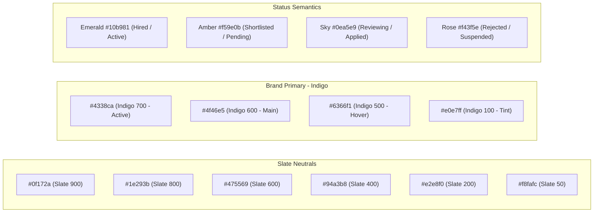
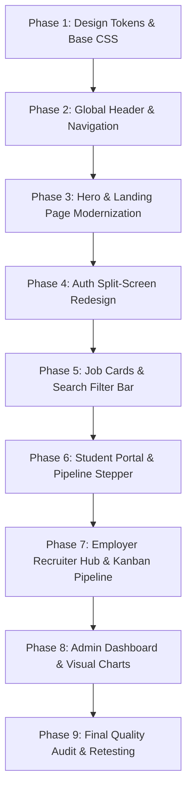

# JobPortal — UI/UX Design System & Visual Enhancement Blueprint

A comprehensive, critical UI audit of current application views and a complete design system overhaul blueprint to transform the platform into a cohesive, modern, SaaS-grade hiring experience.

---

## 1. Executive UI/UX Audit & Critique (Screenshot Analysis)

An in-depth review of the current interface reveals that while the backend features (applications, resume upload, recruiter pipeline, notifications, CSV exports) are robust, the frontend visual presentation currently suffers from **"Bootstrap Scaffolding Syndrome"** — generic container boxes, unstyled controls, and a lack of cohesive visual identity.

### Visual Audit Breakdown by View Category

| View / Page | Current Screenshot | Key UI/UX Deficiencies Identified | High-Impact Modernization Remedy |
| :--- | :--- | :--- | :--- |
| **Homepage** | [`01_public_home.png`](file:///D:/laragon/www/jobportal/screenshots/01_public_home.png) | • Generic diagonal linear gradient (`#0d6efd` to `#4f46e5`).<br>• Stark white transition underneath without visual flow.<br>• Search bar is a plain white box without visual weight or micro-shadows.<br>• Job cards lack visual hierarchy (no company logos, identical plain text blocks). | • Implement a modern radial glow / mesh background with dark slate hero accents.<br>• Floating glassmorphism search pill with icon prefixes.<br>• Redesign job cards with branded company avatar initials, salary chips, and category tags. |
| **Auth Pages** | [`05_public_login.png`](file:///D:/laragon/www/jobportal/screenshots/05_public_login.png)<br>[`06_public_register...`](file:///D:/laragon/www/jobportal/screenshots/06_public_register_student_employer.png) | • Lone white rectangular card floating in a flat gray void (`#f7f9fc`).<br>• Plain Bootstrap radio buttons for Student/Employer.<br>• Stacked inputs without icons or subtle focus rings.<br>• Feels like an internal utility form, not a consumer product. | • Switch to a modern split-screen layout (branded left showcase panel with social proof + clean right form panel).<br>• Interactive role segmented toggle cards with glowing active states.<br>• Floating label inputs with icon prefixes and clear validation hints. |
| **Navbar & Header** | *(Across all views)* | • Saturated solid blue navbar (`bg-primary`) with crowded inline links.<br>• Logout is a standard unstyled pill button.<br>• Unread notification badge is a basic Bootstrap red circle without animations. | • Modern sticky glass navbar (`backdrop-filter: blur(12px)`) in clean deep slate (`#0f172a`) or clean white with a subtle border.<br>• User avatar pill with role badge and dropdown menu.<br>• Animated pulse ring on unread notification bell. |
| **Student Dashboard** | [`08_student_dashboard.png`](file:///D:/laragon/www/jobportal/screenshots/08_student_dashboard.png) | • Saturated blue hero banner repeats the exact same style as the public landing page.<br>• Plain stat blocks with hard left borders (`border-start border-4`).<br>• Recent applications table is plain text without timeline cues. | • Warm personalized greeting card with soft indigo gradient and subtle mesh illustration.<br>• Soft rounded metric cards with vibrant tinted icon backgrounds (`bg-indigo-50`, `text-indigo-600`).<br>• Mini application progress bar right in the table row. |
| **Job Search & Filters** | [`09_student_jobs_catalog.png`](file:///D:/laragon/www/jobportal/screenshots/09_student_jobs_catalog.png) | • 5 stacked HTML `<select>` boxes in a heavy gray form card.<br>• Unequal card heights and cluttered metadata.<br>• Save/Bookmark and Apply buttons look unintegrated. | • Unified horizontal filter toolbar with pill chips for active filters.<br>• Modern SaaS job cards with company avatar badges, bookmark heart micro-toggle, and prominent gradient CTA buttons.<br>• Quick filter chips at the top ("Remote", "Internship", "High Salary"). |
| **Applications Tracker** | [`11_student_applications.png`](file:///D:/laragon/www/jobportal/screenshots/11_student_applications.png) | • Standard tabular data grid with generic badges.<br>• Gives candidates zero emotional excitement or visual understanding of where they stand in the hiring process. | • **Visual Hiring Pipeline Stepper**: Interactive step progress indicator (`Applied` $\rightarrow$ `Under Review` $\rightarrow$ `Shortlisted 🎉` $\rightarrow$ `Hired 🏆`).<br>• Card-based list option with prominent recruiter status pill and quick resume preview drawer. |
| **Profile & Resume** | [`14_student_profile_resume.png`](file:///D:/laragon/www/jobportal/screenshots/14_student_profile_resume.png) | • Circular avatar is a flat blue placeholder.<br>• Thin default progress bar.<br>• Resume upload box looks like a nested gray HTML fieldset. | • Modern profile layout with customizable avatar upload.<br>• Radial circular completeness meter (e.g. 85%).<br>• Drag-and-drop styled resume upload dropzone with PDF thumbnail preview and file size badge. |
| **Employer Pipeline** | [`16_employer_dashboard.png`](file:///D:/laragon/www/jobportal/screenshots/16_employer_dashboard.png)<br>[`20_employer_applicants...`](file:///D:/laragon/www/jobportal/screenshots/20_employer_applicants_pipeline.png) | • Heavy nested rectangular cards inside a gray box.<br>• Recruiter notes textarea is raw and looks like a basic database editor.<br>• Candidate info is cramped without clean spacing. | • Kanban / Pipeline stage board view or streamlined candidate list with pill filters.<br>• Quick action popovers for changing candidate status without reloading.<br>• Dedicated candidate profile slide-out panel or clean modal. |
| **Admin Area** | [`22_admin_dashboard.png`](file:///D:/laragon/www/jobportal/screenshots/22_admin_dashboard.png)<br>[`27_admin_reports...`](file:///D:/laragon/www/jobportal/screenshots/27_admin_reports_analytics.png) | • Scaffolding-like tables with basic Bootstrap border classes.<br>• Progress bars in reports are standard primary/success bars. | • SaaS admin layout with subtle contrast sidebar or compact top bar.<br>• Polished funnel visualization with percentage pill badges and metric trend indicators.<br>• Sleek export action buttons with file format icons. |

---

## 2. Design System Architecture ("Aura Talent UI")

To move away from "divs around text", the entire platform will be underpinned by a formal design token system.

### A. Color Palette & Semantic Design Tokens



#### CSS Token Mapping:
```css
:root {
  /* Brand Primary */
  --primary-50:  #eef2ff;
  --primary-100: #e0e7ff;
  --primary-200: #c7d2fe;
  --primary-500: #6366f1;
  --primary-600: #4f46e5; /* Core Brand */
  --primary-700: #4338ca;
  --primary-gradient: linear-gradient(135deg, #4f46e5 0%, #7c3aed 100%);

  /* Neutrals (Slate) */
  --slate-50:  #f8fafc; /* Body background */
  --slate-100: #f1f5f9; /* Subtle surface */
  --slate-200: #e2e8f0; /* Borders */
  --slate-300: #cbd5e1;
  --slate-500: #64748b; /* Secondary text */
  --slate-700: #334155; /* Headings */
  --slate-900: #0f172a; /* Dark text & dark navbar */

  /* Status Tokens */
  --success-bg: #ecfdf5; --success-text: #065f46; --success-border: #a7f3d0;
  --warning-bg: #fffbeb; --warning-text: #92400e; --warning-border: #fde68a;
  --info-bg:    #f0f9ff; --info-text:    #075985; --info-border:    #bae6fd;
  --danger-bg:  #fff1f2; --danger-text:  #9f1239; --danger-border:  #fecdd3;

  /* Shadows */
  --shadow-xs: 0 1px 2px 0 rgba(15, 23, 42, 0.05);
  --shadow-sm: 0 1px 3px 0 rgba(15, 23, 42, 0.08), 0 1px 2px -1px rgba(15, 23, 42, 0.08);
  --shadow-md: 0 4px 6px -1px rgba(15, 23, 42, 0.08), 0 2px 4px -2px rgba(15, 23, 42, 0.06);
  --shadow-lg: 0 10px 15px -3px rgba(15, 23, 42, 0.08), 0 4px 6px -4px rgba(15, 23, 42, 0.04);
  --shadow-glow: 0 0 20px -3px rgba(79, 70, 229, 0.25);

  /* Radius */
  --radius-sm: 8px;
  --radius-md: 12px;
  --radius-lg: 16px;
  --radius-xl: 24px;
}
```

---

### B. Typography & Hierarchy (Google Font: `Plus Jakarta Sans`)

Replace system fallback fonts with modern, geometric `Plus Jakarta Sans`:
- **Heading 1 / Display**: 800 weight, letter-spacing `-0.03em`, line-height `1.2`.
- **Heading 2 / 3**: 700 weight, letter-spacing `-0.02em`.
- **Body Regular**: 400 weight, line-height `1.6`, color `--slate-500`.
- **Body Semibold**: 600 weight, color `--slate-700`.
- **Badges / Captions**: 600 weight, uppercase tracking `+0.04em`, font-size `0.75rem`.

---

### C. Standardized Component System

#### 1. Modern Glass Navbar
- Sticky top with subtle translucent background: `background: rgba(15, 23, 42, 0.92); backdrop-filter: blur(12px); border-bottom: 1px solid rgba(255,255,255,0.08);`.
- Brand logo: Modern badge icon with gradient glow.
- User profile chip: User initials avatar with role indicator tag.
- Bell icon: Micro pulse indicator for unread alerts.

#### 2. Modern Job Card Component
```text
┌────────────────────────────────────────────────────────────────┐
│  [Logo / Initials]   Senior Frontend Engineer      [₹12-15 LPA]│
│  PixelCraft Studio • Mumbai, India (Hybrid)                    │
│                                                                │
│  [Full-time]  [Engineering]  [1-2 yrs]  [⚡ Closing in 5 days] │
│                                                                │
│  Build reactive modern user interfaces using Next.js and Vue.  │
│                                                                │
│  ────────────────────────────────────────────────────────────  │
│  ♡ Save Bookmark                             [ Apply Now ➜ ]  │
└────────────────────────────────────────────────────────────────┘
```
- Company avatar initial circle with unique soft background color based on name hash.
- Soft border `#e2e8f0` that shifts to `--primary-500` with subtle box-shadow on hover.
- Micro-interactions: Card smoothly shifts `-3px` upward on hover.

#### 3. Visual Application Pipeline Stepper
Instead of just a text badge, candidates see their application progress:
```text
(✓) Applied ────── (✓) Under Review ────── (★) Shortlisted ────── ( ) Offer / Hired
```
Colored segments and subtle pulsating rings indicate current stage.

#### 4. Stat & KPI Cards
- Crisp white surface with 1px border.
- Top-right icon container with soft pastel background (`bg-indigo-50` with `text-indigo-600`).
- Bold metric number with trend badge (`↑ 12% this month`).

#### 5. Forms & Inputs
- Border: `1.5px solid var(--slate-200)`.
- Focus state: `border-color: var(--primary-600)` with `box-shadow: 0 0 0 4px rgba(79, 70, 229, 0.12)`.
- Input icons positioned on the left (`bi-search`, `bi-envelope`, `bi-lock`).

---

## 3. Step-by-Step Implementation Roadmap



### Phase 1: CSS Foundation & Typography Integration
1. Import `Plus Jakarta Sans` from Google Fonts in `includes/header.php`.
2. Rewrite `css/style.css` with:
   - Complete CSS design variables (`:root`).
   - Universal typography rules and smoothing (`-webkit-font-smoothing: antialiased`).
   - Button variants (`.btn-primary-gradient`, `.btn-ghost`, `.btn-soft`).
   - Modern badge styles (`.badge-pill-soft`).
   - Card styles with smooth hover transitions.

### Phase 2: Navigation Bar & Footer Upgrade
1. Update `includes/header.php`:
   - Dark slate glassmorphism navbar (`#0f172a`).
   - Active link indicator line.
   - User profile pill avatar.
   - Polished flash message alerts with icon prefixes and modern close button.
2. Update `includes/footer.php`:
   - Multi-column footer (Product links, Role portals, Quick links, Copyright, Social icons).

### Phase 3: Landing Page (`index.php`) Overhaul
1. Replace flat blue gradient with modern mesh / glow background.
2. Build floating search bar with icon prefixes and pill category buttons.
3. Replace raw stats table with floating glass KPI cards.
4. Upgrade featured job cards with company avatar badges, salary chips, and deadline tags.
5. Add student vs employer dual-track visual cards with clear feature lists and icons.

### Phase 4: Authentication Pages Redesign (`login.php` & `register.php`)
1. Create a modern centered or split card container with soft gradient backdrop.
2. Role selector on registration: Interactive toggle cards with icon, title, and description.
3. Form inputs with icon prefixes and clear validation rings.
4. Social / Trust proof badges below forms.

### Phase 5: Student Hub & Job Discovery (`student/`)
1. **`student/jobs.php`**:
   - Modern horizontal filter toolbar with quick filter pill badges.
   - Uniform 2-column grid of job cards with hover micro-animations.
   - Polished "Apply Now" modal with radio resume picker and drag-drop resume indicator.
2. **`student/applications.php`**:
   - Add visual **4-stage hiring pipeline stepper** for each application.
   - Clean status badges with icons.
   - Polished recruiter note callout card.
3. **`student/profile.php`**:
   - Radial / ring completion meter.
   - Modern resume card with PDF icon, file size, download link, and file replacement button.

### Phase 6: Employer Recruiter Hub (`employer/`)
1. **`employer/dashboard.php`**:
   - Modern recruiter header with company avatar and quick stats.
   - Recent applicants table with candidate avatar initials and stage pills.
2. **`employer/applicants.php`**:
   - Candidate cards with clear two-column layout: Candidate details on left, status update & recruiter notes on right.
   - Quick resume preview button with PDF icon.
3. **`employer/post-job.php`**:
   - Clean multi-section form (Role Details, Compensation & Logistics, Description & Skills) with visual step indicators.

### Phase 7: Administrator Governance (`admin/`)
1. Modern KPI cards with colored trend indicators.
2. Global jobs table with featured star button toggle and status badges.
3. User management with role filter tabs and active/suspended toggles.
4. Visual candidate funnel progress bars with percentage badges in reports.

---

## 4. Key Before vs. After Design Comparison

| Element | Current Prototype Look | Target Modern Redesign ("Aura Talent UI") |
| :--- | :--- | :--- |
| **Typography** | Default Segoe UI / browser fallback | Google Font **Plus Jakarta Sans** with negative heading tracking |
| **Color Scheme** | Flat `#0d6efd` Bootstrap blue & white | Deep Indigo (`#4f46e5`), Slate (`#0f172a`), with pastel semantic status backgrounds |
| **Navbar** | Standard solid blue block with plain text | Frosted glass (`backdrop-filter`) slate navbar with avatar pills & glowing notifications |
| **Job Cards** | Heavy plain border with stacked raw text | Elevated SaaS cards with company initials avatar, salary chips, and hover glow |
| **Application Status**| Static small badge in a table column | Visual 4-step pipeline stepper (`Applied` $\rightarrow$ `Under Review` $\rightarrow$ `Shortlisted` $\rightarrow$ `Hired`) |
| **Form Inputs** | Generic Bootstrap outline box | Subtle `#e2e8f0` border, left icon prefixes, and brand focus glow ring |
| **Buttons** | Default Bootstrap flat buttons | Gradient primary buttons with subtle box shadow (`--shadow-glow`) and active scale |

---

## 5. Verification & Quality Assurance Strategy

1. **Visual Regression Screenshots**: Re-run automated capture to produce updated 27 high-res screenshots.
2. **Interactive Playwright Verification**: Verify all flows (application modal, status update, filter chips) remain 100% operational.
3. **Mobile & Tablet Responsiveness**: Validate on `1920x1080` (Desktop), `768x1024` (Tablet), and `375x812` (Mobile).
